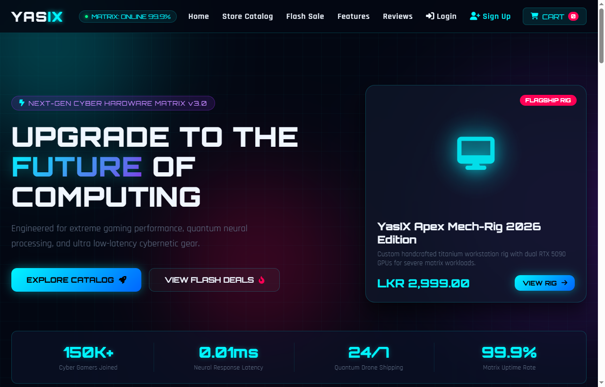
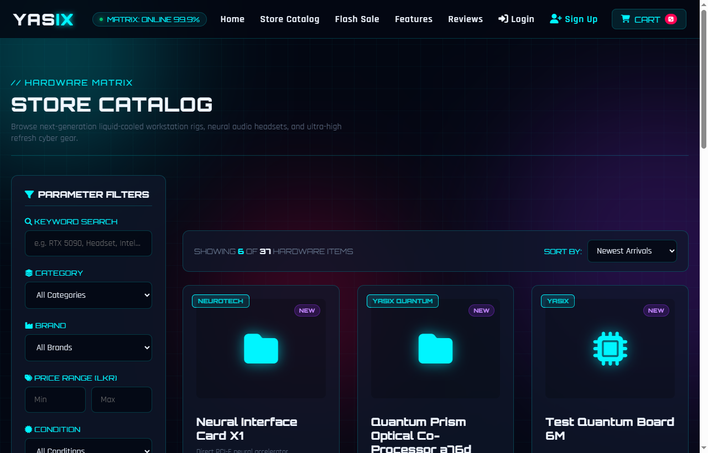
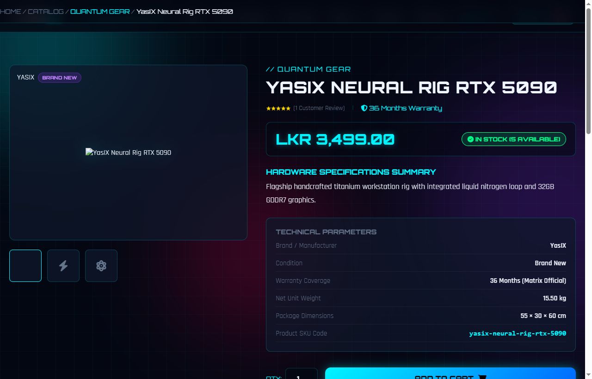
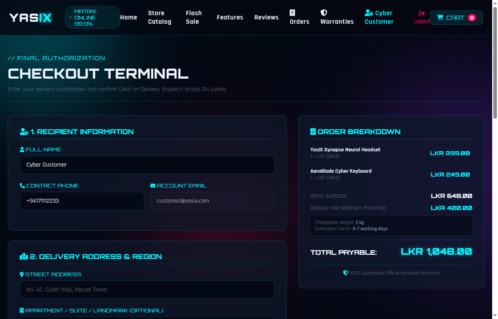
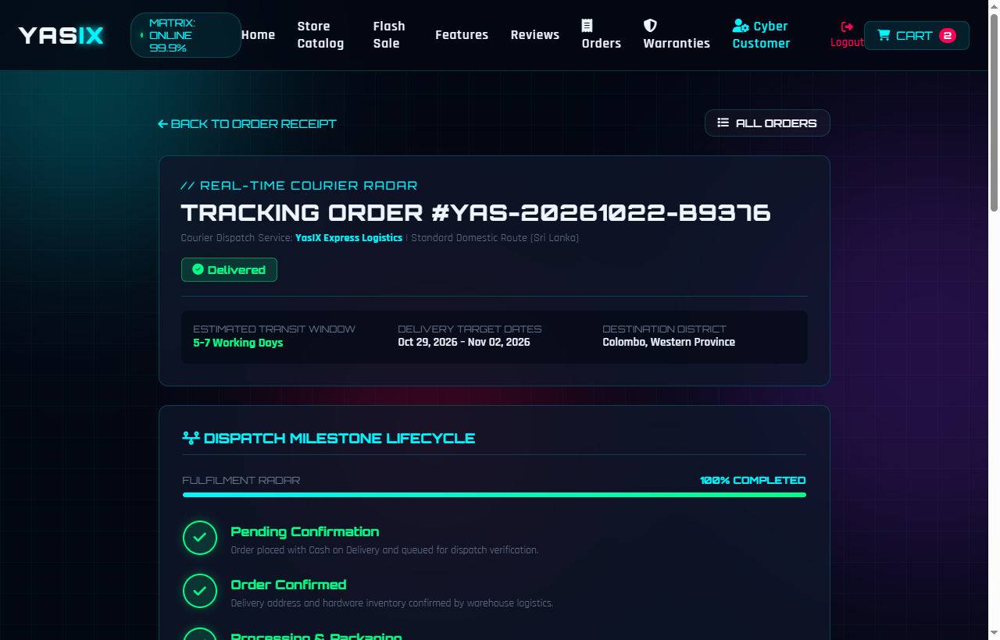
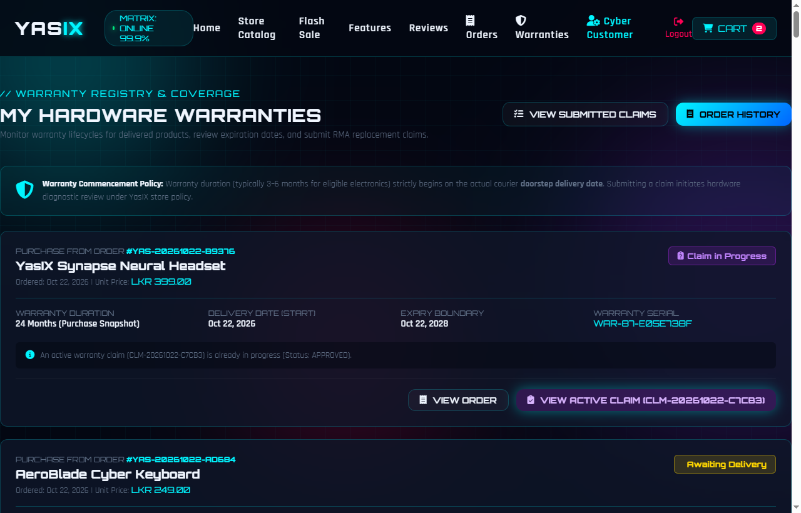
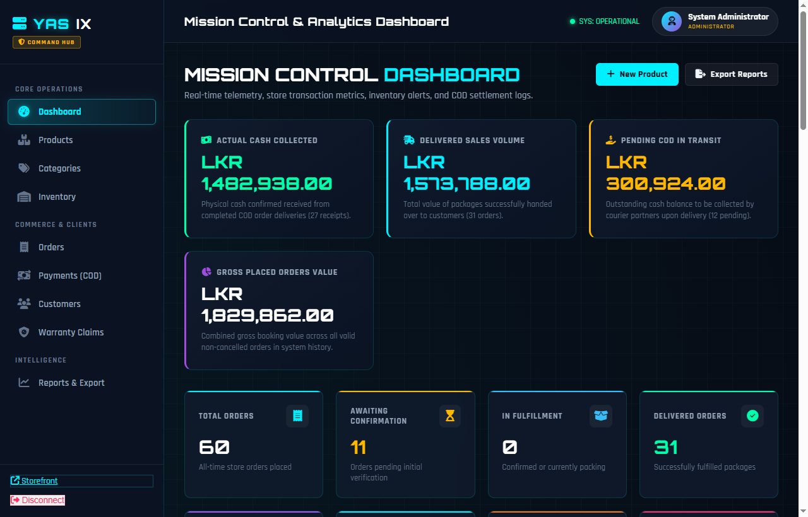
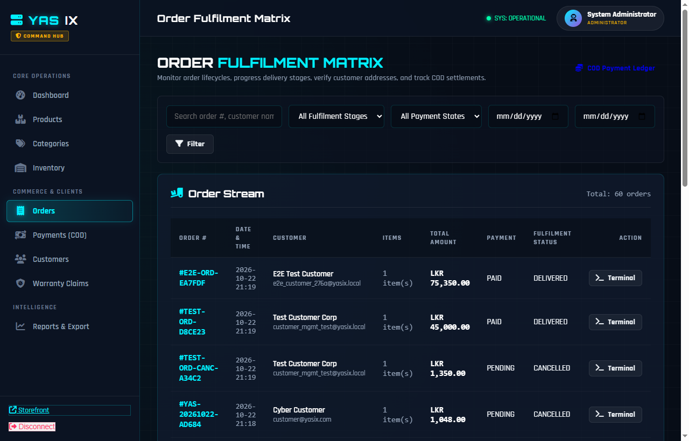

# YasIX Store — Cyber-Themed Tech Hardware E-Commerce Platform

[](https://www.php.net/)
[](https://www.mysql.com/)
[](docs/architecture.md)
[](#-zero-paid-apis-design-philosophy)
[-brightgreen)](#-testing--automated-verification-suites)

**YasIX Store** is a full-stack, portfolio-grade e-commerce application engineered from scratch without monolithic third-party e-commerce platforms, paid external APIs, or proprietary UI frameworks. Built with **pure PHP 8.x, MySQL (PDO), HTML5, CSS3, and vanilla JavaScript**, the application simulates an overseas-sourced specialized hardware and cyber-optics retail platform catering to the Sri Lankan domestic tech market.

The project demonstrates software engineering fundamentals: **clean MVC separation, Service Layer orchestration, Repository data access, strict relational database design, row-level locking for inventory transactions, forward-only finite state machines, decoupled Cash on Delivery (COD) accounting, and defensive security measures (CSRF, XSS, IDOR, CSV injection defense)**.

---

## 📸 Portfolio Showcase & Screenshots

| Storefront Matrix & Flash Deals | Technical Catalog & Search Filters |
|:---:|:---:|
|  |  |
| *Cyber-themed storefront with dynamic database hero, flash deals, and category filtering* | *Multi-criteria hardware filters: categories, brands, price boundaries, in-stock only, and safe sorting* |

| Hardware Specifications & Cart | Checkout & Volumetric Delivery Fee |
|:---:|:---:|
|  |  |
| *Product specifications, real-time stock counters, and warranty duration badges* | *Local rule-based volumetric weight calculation with Cash on Delivery (COD) order placement* |

| Live Dispatch Radar & Tracking | Warranty Registry & RMA Claims |
|:---:|:---:|
|  |  |
| *Visual milestone lifecycle tracking radar with live status updates and audit logs* | *Delivery-based warranty eligibility calculation and customer technical claim lodgment* |

| Admin Command Hub & Real-Time Analytics | Order Fulfilment & Decoupled COD Ledger |
|:---:|:---:|
|  |  |
| *Administrative KPI metrics, inventory depletion alerts, revenue breakdowns, and recent order stream* | *Forward-only fulfilment lifecycle state machine with decoupled COD cash collection terminal* |

---

## 🎯 Problem Statement & Business Context

In emerging e-commerce markets like Sri Lanka, small-to-medium specialized hardware businesses face distinct operational challenges:
1. **High Payment Gateway Overhead**: Standard international merchant gateways charge hefty setup fees, transaction percentages, and foreign exchange cuts that squeeze margins on low-margin tech hardware.
2. **Prevalence of Cash on Delivery (COD)**: Over 80% of local consumers prefer doorstep cash inspection and payment upon delivery. However, standard shopping carts treat COD as "Paid upon Order" or automatically trigger accounting entries, creating severe financial discrepancy when shipments are delayed, returned, or rejected.
3. **Volumetric Island-Wide Shipping Complexity**: Couriers charge based on volumetric dimensions ($L \times W \times H / 5000$) rather than gross physical weight alone. Heavy server chassis or lightweight curved monitors incur radically different shipping costs across Western Province vs. Outstation regions.
4. **Overseas Hardware Warranty Tracking**: Hardware imported from regional hubs (Singapore, Dubai, Taiwan) carries 3–6 month distributor warranties that must commence strictly on the **actual doorstep delivery date**, rather than the purchase or checkout date.

**YasIX Store solves these challenges entirely with native code and zero recurring API costs.**

---

## ⚡ Key Implemented Features

### 🛒 1. Customer Storefront & Catalog Experience
- **Database-Driven Catalog**: Real-time inventory synchronization, dynamic category taxonomy, brand filtering, condition tags (`NEW`, `REFURBISHED`, `CUSTOM_MOD`), and price boundary filtering.
- **Resilient Search & Safe Sorting**: Full-text keyword querying with SQL injection defense and parameter whitelisting (`price_asc`, `price_desc`, `newest`).
- **Persistent Database Shopping Cart**: Server-backed shopping cart stored in relational tables (`carts`, `cart_items`), maintaining customer sessions across devices with stock availability validation.
- **Strict Stock Guarding**: Prevents adding out-of-stock items or exceeding available warehouse balance; updates cart subtotals dynamically.

### 🚚 2. Island-Wide Volumetric Delivery Engine (Zero Paid APIs)
- Configured local rules in `delivery_rules` supporting multi-tier geographical regions (Western Province, Outstation Central, Express Drone Delivery).
- **Volumetric Weight Formula**:
  $$\text{Volumetric Weight (kg)} = \frac{\text{Length (cm)} \times \text{Width (cm)} \times \text{Height (cm)}}{5000}$$
- **Chargeable Weight Rule**: $\text{Chargeable Weight} = \max(\text{Actual Weight}, \text{Volumetric Weight})$.
- Automatically calculates base rates, included weight allowances, and incremental extra kilogram surcharges locally without external shipping APIs.

### 💳 3. Transactional Cash on Delivery (COD) Checkout
- **Atomic Checkout Execution**: Wraps order creation, shipping address snapshotting, inventory decrement, and cart clearance inside an InnoDB transaction with row-level locks (`SELECT ... FOR UPDATE`).
- **Idempotency Protection**: Single-use cryptographic checkout session tokens prevent accidental double-billing or duplicate order submissions upon network delays.
- **Historical Price Snapshotting**: Unit prices, line subtotals, product names, and warranty months are immutably snapshotted in `order_items` at purchase time, ensuring future catalog price changes never mutate historical financial records.

### 📦 4. Customer Order History & Dispatch Radar
- **Authenticated Order Registry (`/orders`)**: Dedicated customer portal displaying purchase history, formatted in Sri Lankan Rupees (LKR), with status badges and specification receipts (`/orders/{order_number}`).
- **Strict IDOR Shield**: Ownership is verified server-side via trusted session tokens; cross-account order access returns a safe 404/403 without leaking order existence.
- **Courier Milestone Radar (`/orders/{order_number}/track`)**: Visual progress timeline illustrating fulfilment stages:
  $$\text{PENDING} \longrightarrow \text{CONFIRMED} \longrightarrow \text{PROCESSING} \longrightarrow \text{SHIPPED} \longrightarrow \text{OUT\_FOR\_DELIVERY} \longrightarrow \text{DELIVERED}$$
- **Early Cancellation Policy**: Customers may cancel only during pre-fulfilment stages (`PENDING`, `CONFIRMED`). Cancellation atomically restores hardware stock via database transactions.

### 🛡️ 5. Delivery-Based Warranty Coverage & RMA Claim Handling
- **Delivery Date Commencement**: Warranty coverage starts strictly on `orders.delivered_at`, never at checkout or dispatch. Undelivered or transit items are ineligible.
- **Expiry Boundary Precision**: Valid through 23:59:59 on the expiration date ($T_{\text{delivered}} + \text{warranty\_months}$).
- **RMA Claim Registry (`/warranties/claims`)**: Customers can file claims for covered hardware with validated failure reasons (`Hardware defect`, `Battery issue`, `Charging issue`, etc.) and serial number telemetry.
- **Anti-Duplicate Shield**: Blocks concurrent duplicate claims for the same hardware asset while a review is underway.

### ⚙️ 6. Professional Administration Matrix
- **Role-Based Access Control (`RoleMiddleware`)**: Protected routes under `/admin/*` requiring database-verified `ADMIN` roles. Unauthorized customers receive a dedicated `403 Forbidden` terminal (`views/403.php`).
- **Live Analytics KPI Cards**: Aggregates total order count, delivered sales revenue, collected COD cash, low-stock threshold alerts, and pending RMA claims directly from MySQL aggregates.
- **SKU & Taxonomy Management (`/admin/products`, `/admin/categories`)**: Create, edit, and soft-deactivate products (`INACTIVE` hides items from public storefront while preserving order references); safe image uploads with MIME verification.
- **Real-Time Stock Ledger & Audit Log (`/admin/inventory`)**: Quick-adjust inventory balances with mandatory audit justification logged in `inventory_logs`.
- **Decoupled COD Settlement Terminal (`/admin/payments`)**: Delivering an order does **not** mark cash as paid. Courier cash remittance must be explicitly recorded by staff, updating `payments.status = 'COMPLETED'` and `orders.payment_status = 'PAID'`.
- **Customer Security Terminal (`/admin/customers`)**: Lifetime customer metrics (orders, spend, RMA history) with one-click account suspension (`SUSPENDED` blocks future logins). Self-suspension shield prevents administrator account lockout.
- **Confidential Staff Notes**: Warranty adjudications keep customer-facing resolutions separate from confidential staff notes (`internal_notes`).
- **CSV Data Export with Formula Injection Defense**: Period performance reports exportable to CSV, neutralizing spreadsheet formula execution attacks (`=, +, -, @, \t, \r`).

---

## 🛠️ Technology Stack & Architecture

```
                   HTTP Request / Response
                             │
                             ▼
                    ┌─────────────────┐
                    │  public/index.php│ Front Controller
                    └────────┬────────┘
                             │
                             ▼
                    ┌─────────────────┐
                    │    App\Router   │ Fast URI Regex Dispatcher
                    └────────┬────────┘
                             │
            ┌────────────────┴────────────────┐
            ▼                                 ▼
   ┌─────────────────┐               ┌─────────────────┐
   │ AuthMiddleware  │               │ RoleMiddleware  │ (ADMIN / CUSTOMER)
   └────────┬────────┘               └────────┬────────┘
            │                                 │
            └────────────────┬────────────────┘
                             │
                             ▼
                  ┌──────────────────────┐
                  │   App\Controllers    │ Input Sanitization & View Prep
                  └──────────┬───────────┘
                             │
                             ▼
                  ┌──────────────────────┐
                  │    App\Services      │ Business Logic & State Machines
                  └──────────┬───────────┘
                             │
                             ▼
                  ┌──────────────────────┐
                  │   App\Repositories   │ PDO Parameterized SQL Queries
                  └──────────┬───────────┘
                             │
                             ▼
                  ┌──────────────────────┐
                  │     MySQL Database   │ 18 Relational Tables (InnoDB)
                  └──────────────────────┘
```

| Layer | Technologies & Implementations | Responsibility |
|---|---|---|
| **Server / Runtime** | PHP 8.2+, Apache / XAMPP, Windows | Front controller execution, session state, strict typing |
| **Data Storage** | MySQL 8.0+ / MariaDB 10.4+, InnoDB | Relational integrity, foreign keys, row-level locks |
| **Data Access** | PDO (PHP Data Objects), Repository Pattern | Strict prepared statements, zero raw SQL concatenation |
| **Business Logic**| Service Layer (`App\Services`) | Delivery calculations, inventory transactions, lifecycle state machines |
| **Presentation**  | MVC Views, Custom Cyber CSS (`style.css`, `admin.css`) | Server-rendered HTML templates, responsive layouts, accessible focus |
| **Client Script** | Vanilla JavaScript (ES6+) | Mobile navigation drawer, touchscreen-aware cursor, countdown timer |

---

## 🔒 Security Implementations

YasIX Store implements defense-in-depth principles across all entry points:

1. **SQL Injection Elimination**: 100% of database interactions use PDO prepared statements with strongly-typed parameter bindings. Zero variable concatenation in queries.
2. **Cross-Site Request Forgery (CSRF)**: All state-changing `POST` requests require a cryptographically secure 256-bit token (`App\Helpers\CSRF`), verified with timing-attack resistant `hash_equals()`. Helper function `csrf_field()` generates standard hidden tokens.
3. **Cross-Site Scripting (XSS)**: All user-supplied output in views is escaped through global helper `e()`, utilizing `htmlspecialchars($string, ENT_QUOTES, 'UTF-8')`.
4. **Broken Object-Level Authorization (IDOR)**: Customer order and warranty views verify account ownership against verified server-side session user IDs (`$_SESSION['user_id']`). Unauthorized cross-tenant queries return 404/403.
5. **Secure Authentication & Password Hashing**: Passwords hashed using industry-standard `PASSWORD_BCRYPT` with dynamic rehash checks upon authentication.
6. **Role-Based Authorization**: Administrative endpoints enforced server-side via `RoleMiddleware`. Manipulating URL query strings or browser cookies cannot bypass admin gates.
7. **CSV Spreadsheet Formula Injection (CWE-1236)**: Neutralizes malicious Excel/Calc formulas (`=cmd`, `@SUM`, `+`, `-`, `\t`, `\r`) during data export by prepending single apostrophes (`'`).
8. **Graceful Accessibility & Reduced Motion**: Full `:focus-visible` keyboard rings, screen reader labels, and compliance with `@media (prefers-reduced-motion: reduce)`.

---

## 📋 Prerequisites & Local Environment

- **Operating System**: Windows 10 / 11, Linux (Ubuntu/Debian), or macOS
- **PHP**: Version 8.1, 8.2, or 8.3 (PHP CLI and Apache module)
  - Required Extensions: `pdo`, `pdo_mysql`, `mbstring`, `openssl`, `session`, `fileinfo`
- **Database**: MySQL 8.0+ or MariaDB 10.4+ (Default in XAMPP)
- **Web Server**: Apache 2.4+ with `mod_rewrite` enabled

---

## 🚀 Step-by-Step Installation Guide (XAMPP / Windows)

### 1. Clone the Repository
Clone the project into your local web server root directory (e.g., `C:\xampp\htdocs\YasIX-Store` or your preferred workspace):

```bash
cd C:\xampp\htdocs
git clone https://github.com/Iksura-Thilakarathna/YasIX-Store.git
cd YasIX-Store
```

### 2. Configure Database Credentials
Copy the example configuration file:

```bash
cp config/config.example.php config/config.php
```

Open `config/config.php` and configure your local MySQL credentials:

```php
return [
    'db' => [
        'host' => '127.0.0.1',
        'port' => 3306,
        'dbname' => 'yasix_store',
        'user' => 'root',
        'pass' => '',
        'charset' => 'utf8mb4'
    ],
    'app' => [
        'name' => 'YasIX Store',
        'env' => 'development', // 'development' or 'production'
        'debug' => true
    ]
];
```

### 3. Initialize Database Schema & Seed Data
Start your local MySQL service (via XAMPP Control Panel or command line), then create the database and import schema:

```bash
# 1. Create database and load base schema
mysql -u root -e "CREATE DATABASE IF NOT EXISTS yasix_store CHARACTER SET utf8mb4 COLLATE utf8mb4_unicode_ci;"
mysql -u root yasix_store < database/schema.sql

# 2. Run incremental migrations (Day 5 & Day 6 schemas)
php database/migrate.php

# 3. Import catalog, category, and regional delivery seeds
mysql -u root yasix_store < database/seed.sql
```

### 4. Provision Seed Administrator Account
Administrator accounts cannot be registered through public customer forms. Use the secure CLI provisioning tool:

```bash
php scripts/provision_admin.php "System Administrator" "admin@yasix.com" "AdminPass123!"
```

*(Note: In development seeds, default accounts are `admin@yasix.com` / `AdminPass123!` for admin, and `customer@yasix.local` / `CustomerPass123!` for testing).*

### 5. Launch the Application
If using XAMPP Apache, ensure VirtualHost points to the `public/` directory, or use PHP's built-in web server:

```bash
# Start built-in local development server
php -S localhost:8000 -t public
```

Access the storefront in your web browser:
- **Customer Storefront**: `http://localhost:8000/`
- **Customer Authentication**: `http://localhost:8000/login`
- **Administrative Command Matrix**: `http://localhost:8000/admin`

---

## 🧪 Testing & Automated Verification Suites

The repository contains an automated regression testing framework executed directly via PHP CLI. Tests require an active local database connection and leave the database in a clean state upon completion:

```bash
# 1. Day 1: Relational Schema & Database Foundation Verification
php tests/verify_foundation.php

# 2. Day 2: Authentication, Password Hashing & Role Assignment Suite
php tests/verify_auth.php

# 3. Day 3: Catalog, Full-Text Search, Filtering & Pagination Suite
php tests/verify_catalog.php

# 4. Day 4: Shopping Cart, Stock Sync & Volumetric Delivery Suite
php tests/verify_day4_complete.php

# 5. Day 5: Order History, Live Courier Tracking & Warranty Suite
php tests/verify_day5_complete.php

# 6. Day 6: Admin Dashboard, Catalog Management, COD Ledger & Security Suite
php tests/verify_day6_complete.php

# 7. Day 7: Comprehensive End-to-End Storefront & Admin Integration Suite
php tests/verify_day7_complete.php

# 8. Day 9: Final Release Readiness & Comprehensive Workflow Audit
php tests/verify_release_readiness.php

# 9. HTTP Front Controller Dispatch & View Route Verification
php tests/test_dispatch.php
```

All 9 test suites pass with **0 failures and 0 regressions**.

---

## 📁 Repository Directory Structure

```
YasIX-Store/
├── app/
│   ├── Controllers/        # Thin HTTP controllers (Storefront, Auth, Cart, Orders, Admin)
│   ├── Database/           # Database PDO Connection singleton
│   ├── Helpers/            # CSRF protection, Session manager, Sanitizer, View renderer
│   ├── Middleware/         # AuthMiddleware (Guests), RoleMiddleware (ADMIN/CUSTOMER)
│   ├── Models/             # Lightweight domain entities
│   ├── Repositories/       # Data Access Objects with parameterized queries
│   ├── Services/           # Domain logic (DeliveryCalculator, Checkout, Orders, Warranty)
│   └── Router.php          # Fast HTTP request pattern matching router
├── config/
│   ├── config.example.php  # Environment template for local configuration
│   └── config.php          # Ignored local configuration (DB credentials & environment)
├── database/
│   ├── migrations/         # Incremental schema evolution scripts (Day 5, Day 6)
│   ├── migrate.php         # Automated CLI migration runner
│   ├── schema.sql          # Base relational schema (18 tables)
│   └── seed.sql            # Seed dataset (Categories, hardware products, delivery rules)
├── docs/
│   ├── architecture.md     # In-depth architectural patterns & request lifecycle
│   ├── database.md         # Database ER diagram & schema dictionary
│   ├── workflows.md        # Customer & Administrator sequence diagrams
│   └── screenshots/        # High-resolution application screenshots
├── public/
│   ├── assets/
│   │   ├── css/            # Cyber styles: style.css (Storefront), admin.css (Admin)
│   │   └── images/         # Static assets and hardware product image uploads
│   └── index.php           # Front Controller entry point
├── routes/
│   └── web.php             # Unified web routing manifest (GET / POST routes)
├── scripts/
│   └── provision_admin.php # Secure CLI tool to provision administrative users
├── tests/                  # 17 automated regression & end-to-end verification suites
├── .gitignore              # Ignored local configs, logs, caches, and test artifacts
├── LICENSE                 # Open-source MIT License
└── README.md               # Primary project documentation
```

---

## ⚠️ Known Limitations & Future Roadmap

As an authentic academic and portfolio software engineering showcase, YasIX Store focuses on structural design and architectural integrity. Acknowledged limitations and planned future expansions include:

- [ ] **Payment Gateway Integration**: Initial implementation centers around Cash on Delivery (COD). Future versions can introduce a modular Payment Gateway Provider interface (e.g. PayHere, Stripe, or Web3 crypto gateways).
- [ ] **Automated Email Notifications**: Order receipts and claim notifications currently output directly on screen and log to `notifications`. Future enhancements will integrate SMTP (PHPMailer / Symfony Mailer) for automated dispatch emails.
- [ ] **Multi-Image Product Galleries**: Currently supports primary product image snapshots; secondary thumbnails and interactive 3D model viewers are planned.
- [ ] **Real-Time Courier API Webhooks**: Tracking milestones are driven by administrative state transitions; integration with CityPak / PromptX tracking webhooks is architecturally pre-configured.

---

## 📄 License & Academic Attribution

This project is open-source software licensed under the **[MIT License](LICENSE)**.

Developed by **Iksura Thilakarathna** as an e-commerce portfolio application demonstrating software architecture, database engineering, and full-stack web development.
