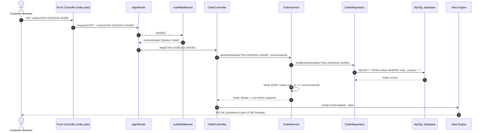

# YasIX Store — System Architecture Documentation

This document describes the architectural design, component layers, request lifecycle, and software engineering patterns implemented across the **YasIX Store** application.

---

## 🏛️ Architectural Overview

YasIX Store is architected as a **Modular Monolith** adhering to the **Model-View-Controller (MVC)** design pattern, augmented with a distinct **Service Layer** and **Repository Pattern**. 

The architecture avoids monolithic third-party frameworks to maintain minimal runtime overhead, full source-code transparency, zero vendor lock-in, and strict control over state machines and transactional boundaries.

```mermaid
flowchart TD
    Client["Client Browser / Mobile Device"] -->|HTTP Request| FC["public/index.php (Front Controller)"]
    
    subgraph Core ["Application Core & Bootstrap"]
        FC --> BS["Bootstrap & Helpers (Session, CSRF, Sanitizer)"]
        BS --> Router["App\\Router (URI Pattern Matcher)"]
    end
    
    subgraph Middleware ["Middleware Inspection Pipeline"]
        Router --> MW1{"AuthMiddleware"}
        MW1 -->|Unauthenticated| RedirLogin["Redirect /login"]
        MW1 -->|Authenticated| MW2{"RoleMiddleware"}
        MW2 -->|Unauthorized (Non-Admin)| Err403["403 Forbidden Terminal"]
        MW2 -->|Authorized (ADMIN / CUSTOMER)| Ctrl["App\\Controllers\\*"]
    end
    
    subgraph Business ["Domain & Persistence Layers"]
        Ctrl -->|Invoke Domain Operations| Svc["App\\Services\\* (Business Rules)"]
        Svc -->|State Machine & Calculations| Repo["App\\Repositories\\* (Data Access)"]
        Repo -->|Prepared PDO Queries| DB[("MySQL InnoDB Database (18 Tables)")]
    end
    
    subgraph Presentation ["View Rendering Layer"]
        Ctrl -->|Render Dynamic Template| ViewEngine["App\\Helpers\\View"]
        ViewEngine --> Layout["Cyber Layouts (header, footer, nav)"]
        Layout --> HTML["HTML5 / CSS3 / Vanilla JS Response"]
        HTML -->|HTTP Response| Client
    end
```

---

## 🧩 Architectural Layers & Responsibilities

### 1. Front Controller Entry Point (`public/index.php`)
All inbound HTTP requests are intercepted by `public/index.php`. The front controller:
- Registers the PSR-4 class autoloader for the `App\` namespace.
- Bootstraps global helper functions (`e()`, `formatCurrency()`, `formatLKR()`, `csrf_field()`).
- Initializes session security and loads configuration from `.env` via `config/config.php`.
- Instantiates the `App\Router` with the routing definitions from `routes/web.php` and dispatches the request.

### 2. Fast Regex Router (`app/Router.php`)
The router maps HTTP method and URI paths to corresponding controller actions.
- Supports static routes (`/cart`, `/admin/products`) and parameterized dynamic routes (`/products/{slug}`, `/orders/{order_number}`, `/admin/customers/{id}`).
- Translates URL tokens into named parameters passed to controller action methods.
- Triggers custom `404 Not Found` handlers for unregistered endpoints.

### 3. Middleware Pipeline (`app/Middleware/`)
Intercepts requests prior to controller dispatch:
- **`AuthMiddleware`**: Enforces user authentication for protected customer routes (`/cart`, `/checkout`, `/orders`, `/warranties`, `/account`). Automatically captures the attempted URI to preserve the return path post-login.
- **`RoleMiddleware`**: Enforces role-based access control. All administrative routes under `/admin/*` require the `ADMIN` role verified from server-side session and database queries. Unauthorized customers receive a hardened `403 Forbidden` response (`views/403.php`).

### 4. Controller Layer (`app/Controllers/`)
Thin HTTP entrypoints responsible for:
- Validating and sanitizing input parameters.
- Enforcing CSRF token verification on all state-changing `POST` requests.
- Delegating complex domain tasks to appropriate services.
- Preparing view data models and invoking view templates.

### 5. Service Layer (`app/Services/`)
Encapsulates all business rules, algorithms, and transactional state machines:
- **`DeliveryCalculatorService`**: Computes actual vs. volumetric chargeable weights without third-party logistics APIs.
- **`CheckoutService`**: Coordinates idempotency checks, atomic stock decrements, and order creation inside InnoDB transactions.
- **`OrderService`**: Manages forward-only order lifecycle transitions, courier milestone tracking, and customer IDOR isolation.
- **`WarrantyService`**: Calculates delivery-based coverage dates, evaluates RMA claim eligibility, and adjudicates technical claims.
- **`ProductService`**: Manages catalog queries, SQL-safe sorting, category taxonomy, and administrative inventory adjustments.
- **`AdminService`**: Compiles real-time dashboard analytics and generates CSV reports with formula injection neutralization.

### 6. Repository Pattern (`app/Repositories/`)
Separates domain logic from direct database SQL queries:
- Every database interaction uses PDO prepared statements with strict parameter binding.
- Implements row-level locking (`SELECT ... FOR UPDATE`) during atomic inventory decrements and stock restorations.
- Centralizes domain entities across dedicated repositories: `UserRepository`, `ProductRepository`, `CategoryRepository`, `CartRepository`, `OrderRepository`, `DeliveryRuleRepository`, `WarrantyRepository`, and `AdminRepository`.

### 7. Database Layer (`app/Database/Connection.php`)
Singleton database connection manager maintaining a single active PDO instance per request with UTF-8 (`utf8mb4`) encoding, exception-driven error handling (`PDO::ERRMODE_EXCEPTION`), and disabled emulated prepared statements.

---

## 🔄 Request-Response Lifecycle Flow



---

## 🛡️ Architectural Security Defenses

| Threat Vector | Mitigation Strategy | Architectural Component |
|---|---|---|
| **SQL Injection (SQLi)** | 100% prepared PDO statements, strict type binding, zero query concatenation | `App\Repositories\*` |
| **Cross-Site Request Forgery (CSRF)** | 256-bit cryptographically secure tokens verified with `hash_equals()` on all POSTs | `App\Helpers\CSRF` |
| **Cross-Site Scripting (XSS)** | Mandatory contextual HTML escaping via global helper `e()` | `app/Helpers/functions.php` |
| **Broken Object-Level Auth (IDOR)** | Server-side tenant checks matching `$order['user_id'] === $sessionUserId` | `App\Services\OrderService` |
| **CSV Formula Injection (CWE-1236)**| Neutralizes spreadsheet execution prefixes (`=, +, -, @, \t, \r`) with `'` | `App\Services\AdminService` |
| **Privilege Escalation** | Server-side role checks verifying database roles; isolated `/admin` routes | `App\Middleware\RoleMiddleware` |
| **Double-Spending & Race Conditions**| Row-level database locks (`SELECT ... FOR UPDATE`) inside atomic transactions | `App\Services\CheckoutService` |
