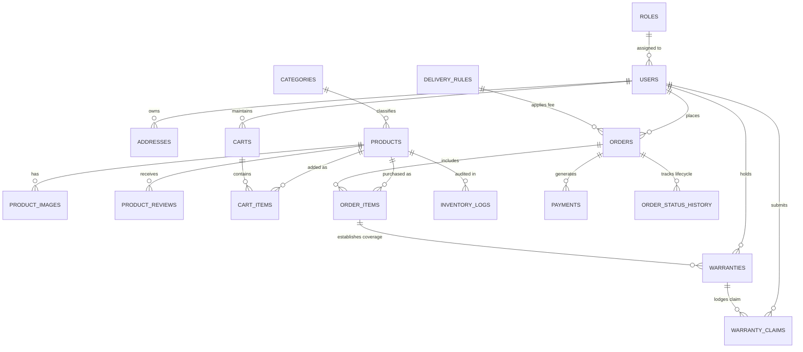

# YasIX Store — Relational Database Schema & Data Dictionary

This document details the relational database design, table relationships, entity data dictionaries, indexing strategies, and transactional audit trails implemented in **YasIX Store**.

---

## 🗄️ Relational Entity-Relationship Diagram (ERD)

---

## 📋 Comprehensive Data Dictionary

### 1. User & Access Control

#### `roles`
Defines authorization access levels.
| Column | Type | Constraints | Description |
|---|---|---|---|
| `id` | INT | PRIMARY KEY, AUTO_INCREMENT | Unique role identifier |
| `name` | VARCHAR(50) | UNIQUE, NOT NULL | Role name (`ADMIN`, `CUSTOMER`) |
| `description` | VARCHAR(255) | NULL | Descriptive summary of permissions |
| `created_at` | TIMESTAMP | DEFAULT CURRENT_TIMESTAMP | Record creation timestamp |

#### `users`
Registered customer accounts and store administrators.
| Column | Type | Constraints | Description |
|---|---|---|---|
| `id` | INT | PRIMARY KEY, AUTO_INCREMENT | Unique user identifier |
| `role_id` | INT | FOREIGN KEY -> `roles(id)` | Assigned access tier |
| `name` | VARCHAR(100) | NOT NULL | Customer or staff full name |
| `email` | VARCHAR(150) | UNIQUE, NOT NULL | Unique login email address |
| `password` | VARCHAR(255) | NOT NULL | Bcrypt password hash |
| `phone` | VARCHAR(20) | NULL | Primary contact phone number |
| `status` | ENUM | DEFAULT 'ACTIVE' | Account state: `ACTIVE`, `SUSPENDED` |
| `created_at` | TIMESTAMP | DEFAULT CURRENT_TIMESTAMP | Registration date |
| `updated_at` | TIMESTAMP | ON UPDATE CURRENT_TIMESTAMP | Last modification date |

#### `addresses`
Saved shipping and billing destinations.
| Column | Type | Constraints | Description |
|---|---|---|---|
| `id` | INT | PRIMARY KEY, AUTO_INCREMENT | Unique address identifier |
| `user_id` | INT | FOREIGN KEY -> `users(id)` | Account owner |
| `address_line1` | VARCHAR(255) | NOT NULL | Primary street address |
| `address_line2` | VARCHAR(255) | NULL | Suite, floor, or apartment |
| `city` | VARCHAR(100) | NOT NULL | City or town |
| `state` | VARCHAR(100) | NOT NULL | Province or administrative district |
| `postal_code` | VARCHAR(20) | NOT NULL | Postal routing code |
| `country` | VARCHAR(100) | DEFAULT 'Sri Lanka' | Destination country |
| `is_default` | TINYINT(1) | DEFAULT 0 | Default destination flag |

---

### 2. Product Catalog & Inventory Matrix

#### `categories`
Hierarchical product categorization.
| Column | Type | Constraints | Description |
|---|---|---|---|
| `id` | INT | PRIMARY KEY, AUTO_INCREMENT | Unique category identifier |
| `name` | VARCHAR(100) | NOT NULL | Category display name |
| `slug` | VARCHAR(120) | UNIQUE, NOT NULL | URL-safe slug |
| `description` | TEXT | NULL | Category description |
| `status` | ENUM | DEFAULT 'ACTIVE' | State: `ACTIVE`, `INACTIVE` |

#### `products`
Master catalog items with physical dimensions and warranty durations.
| Column | Type | Constraints | Description |
|---|---|---|---|
| `id` | INT | PRIMARY KEY, AUTO_INCREMENT | Unique product SKU identifier |
| `category_id` | INT | FOREIGN KEY -> `categories(id)` | Parent category |
| `name` | VARCHAR(200) | NOT NULL | Product specification name |
| `slug` | VARCHAR(220) | UNIQUE, NOT NULL | Canonical URL slug |
| `description` | TEXT | NULL | Detailed technical specifications |
| `brand` | VARCHAR(100) | DEFAULT 'YasIX' | Brand name |
| `price` | DECIMAL(10,2) | NOT NULL, >= 0 | Selling unit price (LKR / USD) |
| `stock_quantity` | INT | NOT NULL, >= 0 | Real-time warehouse balance |
| `weight` | DECIMAL(8,2) | DEFAULT 0.00 | Gross weight in kilograms |
| `package_length` | DECIMAL(8,2) | DEFAULT 0.00 | Box length in centimeters |
| `package_width` | DECIMAL(8,2) | DEFAULT 0.00 | Box width in centimeters |
| `package_height` | DECIMAL(8,2) | DEFAULT 0.00 | Box height in centimeters |
| `warranty_months` | INT | DEFAULT 12 | Standard coverage duration (months) |
| `condition` | ENUM | DEFAULT 'NEW' | Condition: `NEW`, `REFURBISHED`, `CUSTOM_MOD` |
| `status` | ENUM | DEFAULT 'AVAILABLE' | State: `AVAILABLE`, `OUT_OF_STOCK`, `INACTIVE`, `DISCONTINUED` |
| `featured` | TINYINT(1) | DEFAULT 0 | Promoted on storefront hero/specials |

#### `inventory_logs`
Immutable audit ledger recording all warehouse stock adjustments.
| Column | Type | Constraints | Description |
|---|---|---|---|
| `id` | INT | PRIMARY KEY, AUTO_INCREMENT | Unique log entry ID |
| `product_id` | INT | FOREIGN KEY -> `products(id)` | Audited SKU |
| `user_id` | INT | FOREIGN KEY -> `users(id)` | Admin actor executing adjustment |
| `change_quantity` | INT | NOT NULL | Delta units adjusted (+/-) |
| `previous_stock` | INT | NOT NULL | Warehouse stock before change |
| `new_stock` | INT | NOT NULL | Warehouse stock after change |
| `reason` | VARCHAR(255) | NOT NULL | Audit justification |
| `created_at` | TIMESTAMP | DEFAULT CURRENT_TIMESTAMP | Audit timestamp |

---

### 3. Shopping Cart & Volumetric Shipping Engine

#### `carts` & `cart_items`
Persistent database cart sessions surviving cross-device logins.
- `carts.user_id`: Foreign key linked to `users(id)`.
- `cart_items.cart_id`: Foreign key linked to `carts(id)` with cascade deletion.
- `cart_items.product_id`: Foreign key linked to `products(id)`.
- `cart_items.quantity`: Positive integer bounded by current warehouse stock balance.

#### `delivery_rules`
Configured geographical shipping rates and volumetric formulas.
| Column | Type | Constraints | Description |
|---|---|---|---|
| `id` | INT | PRIMARY KEY, AUTO_INCREMENT | Rule identifier |
| `region_name` | VARCHAR(100) | NOT NULL | Geographical area (e.g. Western Province) |
| `base_fee` | DECIMAL(10,2) | NOT NULL | Flat rate base fee (LKR) |
| `included_weight_kg`| DECIMAL(8,2) | DEFAULT 1.00 | Base fee weight allowance |
| `additional_kg_fee` | DECIMAL(10,2) | DEFAULT 50.00 | Fee per extra kilogram |
| `volumetric_divisor`| INT | DEFAULT 5000 | Standard courier divisor ($L \times W \times H / 5000$) |
| `is_active` | TINYINT(1) | DEFAULT 1 | Active rate flag |

---

### 4. Orders, Historical Snapshots & Decoupled COD Payments

#### `orders`
Master order record representing transactions.
| Column | Type | Constraints | Description |
|---|---|---|---|
| `id` | INT | PRIMARY KEY, AUTO_INCREMENT | Unique numeric ID |
| `order_number` | VARCHAR(50) | UNIQUE, NOT NULL | Formatted tracking code (e.g. `YAS-20261022-4AA90`) |
| `user_id` | INT | FOREIGN KEY -> `users(id)` | Purchasing customer |
| `delivery_rule_id` | INT | FOREIGN KEY -> `delivery_rules(id)` | Applied delivery tariff |
| `subtotal` | DECIMAL(10,2) | NOT NULL | Sum of line subtotals |
| `delivery_fee` | DECIMAL(10,2) | NOT NULL | Calculated shipping charge |
| `total_amount` | DECIMAL(10,2) | NOT NULL | Order gross total |
| `status` | ENUM | DEFAULT 'PENDING' | Fulfilment stage: `PENDING`, `CONFIRMED`, `PROCESSING`, `SHIPPED`, `OUT_FOR_DELIVERY`, `DELIVERED`, `CANCELLED`, `RETURNED` |
| `payment_status` | ENUM | DEFAULT 'PENDING' | Settlement state: `PENDING`, `PAID`, `FAILED` |
| `payment_method` | VARCHAR(50) | DEFAULT 'COD' | Payment protocol (`COD`) |
| `shipping_name` | VARCHAR(100) | NOT NULL | Recipient name snapshot |
| `shipping_phone` | VARCHAR(20) | NOT NULL | Recipient phone snapshot |
| `shipping_address` | VARCHAR(255) | NOT NULL | Street address snapshot |
| `shipping_city` | VARCHAR(100) | NOT NULL | City destination snapshot |
| `shipping_state` | VARCHAR(100) | NOT NULL | Administrative province snapshot |
| `shipping_postal_code`| VARCHAR(20) | NOT NULL | Postal code snapshot |
| `delivered_at` | TIMESTAMP | NULL | Doorstep courier delivery timestamp |
| `cancelled_at` | TIMESTAMP | NULL | Pre-fulfilment cancellation timestamp |
| `created_at` | TIMESTAMP | DEFAULT CURRENT_TIMESTAMP | Order submission timestamp |

#### `order_items` (Purchase-Time Immutability)
Individual products ordered. Immutably preserves unit prices and warranty durations:
| Column | Type | Description |
|---|---|---|
| `id` | INT | Primary key |
| `order_id` | INT | FK -> `orders(id)` |
| `product_id` | INT | FK -> `products(id)` |
| `unit_price` | DECIMAL(10,2) | **Historical price snapshot** at moment of purchase |
| `quantity` | INT | Number of units purchased |
| `subtotal` | DECIMAL(10,2) | Line subtotal ($P_{\text{snap}} \times Q$) |
| `product_name` | VARCHAR(200) | Name snapshot |
| `warranty_months` | INT | **Historical warranty duration snapshot** (3–6 months) |

#### `payments` (Decoupled COD Cash Ledger)
Tracks physical cash remittance from delivery couriers:
| Column | Type | Description |
|---|---|---|
| `id` | INT | Primary key |
| `order_id` | INT | FK -> `orders(id)` |
| `amount` | DECIMAL(10,2) | Expected cash collection amount |
| `status` | ENUM | `PENDING`, `COMPLETED`, `FAILED` |
| `collected_at` | TIMESTAMP | Explicit courier cash deposit timestamp |
| `collected_by_user_id`| INT | FK -> `users(id)` (Admin staff recording settlement) |
| `notes` | TEXT | Remittance reference or bank slip audit notes |

#### `order_status_history`
Full audit trail of all lifecycle status transitions:
| Column | Type | Description |
|---|---|---|
| `id` | INT | Primary key |
| `order_id` | INT | FK -> `orders(id)` |
| `status` | VARCHAR(50) | Stage advanced to |
| `notes` | TEXT | Transition reason (e.g. Courier tracking code) |
| `created_by` | INT | FK -> `users(id)` (Staff or customer actor) |
| `created_at` | TIMESTAMP | Transition timestamp |

---

### 5. Warranties & Technical Claim Handling

#### `warranties`
Established warranty contracts created upon actual doorstep delivery:
- `order_item_id`: Unique reference to `order_items(id)`.
- `warranty_start_date`: Strictly set to `orders.delivered_at`.
- `warranty_end_date`: Calculated as $\text{delivered\_at} + \text{warranty\_months}$.
- `status`: `ACTIVE`, `EXPIRED`, `VOIDED`.

#### `warranty_claims`
Technical RMA defect claims submitted by customers:
| Column | Type | Description |
|---|---|---|
| `id` | INT | Primary key |
| `claim_number` | VARCHAR(50) | Formatted claim code (e.g. `CLM-20261022-6A31D`) |
| `warranty_id` | INT | FK -> `warranties(id)` |
| `order_item_id` | INT | FK -> `order_items(id)` |
| `user_id` | INT | FK -> `users(id)` (Claiming customer) |
| `claim_reason` | VARCHAR(100) | Defect category (`Hardware defect`, `Battery issue`, etc.) |
| `issue_description`| TEXT | Detailed fault description |
| `serial_number` | VARCHAR(100) | Hardware serial number |
| `status` | ENUM | `SUBMITTED`, `UNDER_REVIEW`, `APPROVED`, `REJECTED`, `RESOLVED`, `CLOSED` |
| `admin_decision` | VARCHAR(255) | Customer-facing adjudication summary |
| `resolution_details`| TEXT | Customer-facing replacement/repair instructions |
| `internal_notes` | TEXT | **Confidential staff notes & supplier RMA codes** |
| `reviewed_by` | INT | FK -> `users(id)` (Admin adjudicator) |
| `reviewed_at` | TIMESTAMP | Review timestamp |
