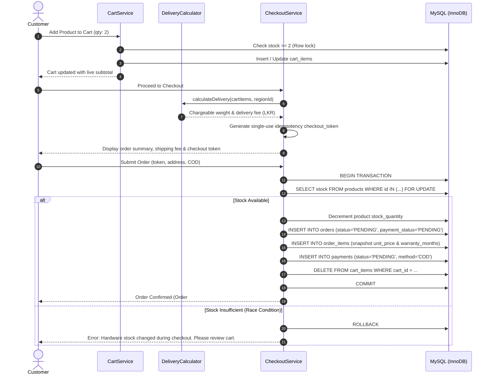
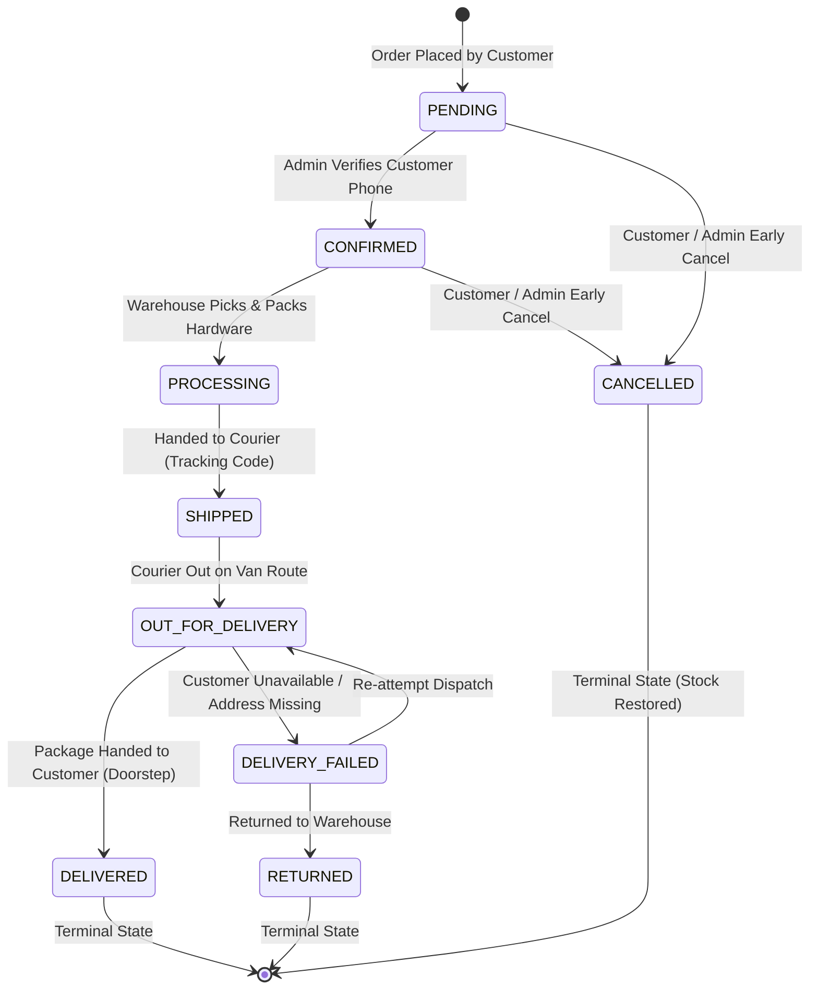
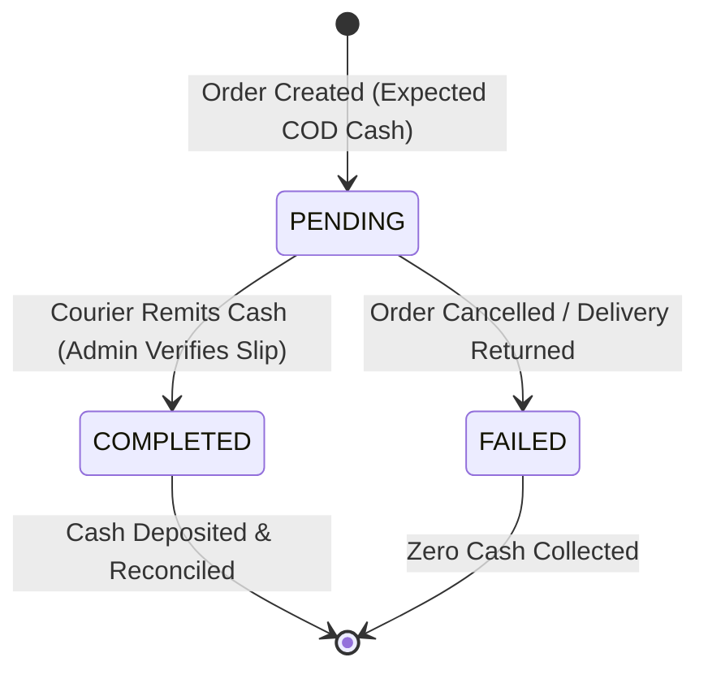
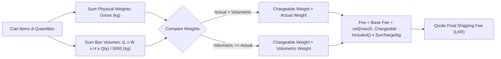

# YasIX Store — Business Workflows & State Machines

This document illustrates the operational business workflows, state machines, and sequence lifecycles governing customer commerce and administrative operations in **YasIX Store**.

---

## 🛒 1. Customer Shopping & Atomic Checkout Lifecycle



---

## 🚚 2. Order Fulfilment State Machine vs. COD Decoupled Settlement

In cash-on-delivery e-commerce, order fulfilment and financial cash collection are two **strictly decoupled lifecycles**. Reaching the `DELIVERED` status does **not** mark cash as received.

### Order Fulfilment State Machine
The state machine strictly enforces forward-only progression. Backward transitions (e.g. from `SHIPPED` back to `PENDING`) are rejected by the domain validator.



### Decoupled COD Cash Collection Lifecycle


> [!NOTE]
> When `orders.status` reaches `DELIVERED`, `orders.delivered_at` is timestamped. However, `orders.payment_status` remains `PENDING` until store staff physically verifies the courier cash deposit in `/admin/payments`, advancing `payments.status` to `COMPLETED` and `orders.payment_status` to `PAID`.

---

## 🔄 3. Controlled Order Cancellation & Stock Restoration

Customers are permitted to cancel orders only prior to physical warehouse processing.

```mermaid
flowchart TD
    Req["Customer Requests Order Cancellation"] --> CheckStatus{"Is Status PENDING or CONFIRMED?"}
    
    CheckStatus -->|No (PROCESSING, SHIPPED, DELIVERED)| Reject["Reject: Order has entered physical dispatch queue"]
    
    CheckStatus -->|Yes| Lock["BEGIN TRANSACTION (InnoDB)"]
    Lock --> UpdOrder["Update orders.status = 'CANCELLED', cancelled_at = NOW()"]
    UpdOrder --> LoopItems["For each item in order_items"]
    LoopItems --> RestoreStock["UPDATE products SET stock_quantity = stock_quantity + qty WHERE id = ?"]
    RestoreStock --> Audit["INSERT INTO inventory_logs (reason='Customer Cancellation')"]
    Audit --> UpdPay["UPDATE payments SET status = 'FAILED'"]
    UpdPay --> Commit["COMMIT TRANSACTION"]
    Commit --> Success["Return Success & Notify Customer"]
```

---

## 🛡️ 4. Delivery-Based Warranty & RMA Claim Lifecycle

Warranties begin on the **actual doorstep delivery date**, never on the checkout date.

```mermaid
flowchart TD
    Cust["Customer Navigates to /warranties"] --> CheckDelivered{"Has Order Item Reached DELIVERED?"}
    
    CheckDelivered -->|No| Ineligible1["Ineligible: Hardware has not completed doorstep delivery"]
    
    CheckDelivered -->|Yes| CheckDuration{"Has Warranty Expired? (NOW <= delivered_at + warranty_months)"}
    CheckDuration -->|No (Expired)| Ineligible2["Ineligible: Coverage expired on calculated boundary date"]
    
    CheckDuration -->|Yes| CheckActiveClaim{"Is an active claim already pending for this item?"}
    CheckActiveClaim -->|Yes| Ineligible3["Blocked: Claim is already actively undergoing review"]
    
    CheckActiveClaim -->|No| ShowForm["Render Claim Submission Terminal"]
    ShowForm --> Submit["Customer Submits Reason & Fault Telemetry"]
    Submit --> SubState["Status: SUBMITTED"]
    
    SubState --> StaffRev["Admin Transitions to UNDER_REVIEW (Logs diagnostic notes)"]
    StaffRev --> Decision{"Staff Adjudication Decision"}
    
    Decision -->|Rejected| Rej["Status: REJECTED (Reason communicated to customer)"]
    Decision -->|Approved| App["Status: APPROVED (RMA supplier credit issued)"]
    App --> Res["Status: RESOLVED (Replacement hardware dispatched via courier)"]
    Res --> Close["Status: CLOSED (Claim archived)"]
```

---

## ⚖️ 5. Volumetric Weight Delivery Fee Algorithm

Couriers operating across Sri Lanka charge based on the greater of actual scale weight vs. dimensional bulkiness:



### Reference Tariff Rules (Configured in `delivery_rules`)
1. **Western Province (ID: 1)**: Base Fee: LKR 350.00 (up to 1.0 kg), Surcharge: LKR 50.00/extra kg.
2. **Outstation Central (ID: 2)**: Base Fee: LKR 450.00 (up to 1.0 kg), Surcharge: LKR 75.00/extra kg.
3. **Express Drone Delivery (ID: 3)**: Base Fee: LKR 950.00 (up to 1.0 kg), Surcharge: LKR 100.00/extra kg.

---

## 🔐 6. Administrator Privilege Shield

Administrative routes (`/admin/*`) enforce two-tiered protection:

```mermaid
flowchart TD
    Req["Request to /admin/*"] --> CheckAuth{"Is Session Logged In?"}
    
    CheckAuth -->|No| Redir["302 Redirect to /admin/login"]
    
    CheckAuth -->|Yes| CheckRole{"Is role_name === 'ADMIN'?"}
    CheckRole -->|No (CUSTOMER)| Block["403 Forbidden Terminal (Access Denied)"]
    
    CheckRole -->|Yes| Action{"Is Admin Performing Action?"}
    
    Action -->|Suspend Self| BlockSelf["Security Policy: Cannot suspend active administrative session"]
    Action -->|Alter other Admin| BlockAdmin["Security Policy: Cannot modify peer administrator via customer terminal"]
    Action -->|Standard Task| Allow["Execute Admin Operation (Audit Logged)"]
```
